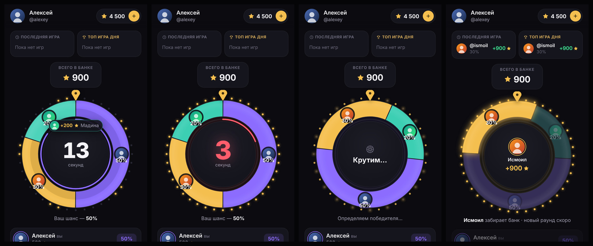
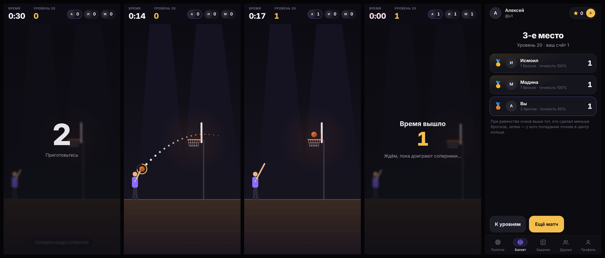

# Roulette Arena

Telegram Mini App + бот. Игроки ставят звёзды, каждый получает сектор колеса пропорционально ставке,
победитель забирает банк раунда.



## Как работает

| | |
|---|---|
| **Рулетка** | Открывается сразу. 1 игрок — ожидание. Со второй ставкой начинается отсчёт 15 секунд, пока могут присоединиться другие. Затем колесо крутится, и победитель забирает банк (сумма ставок минус 10%, комиссия в игре не показывается). Шанс равен доле ставки. Победителя выбирает сервер (криптографический генератор случайных чисел), у всех игроков колесо останавливается в одной и той же точке. |
| **Пополнение** | Звёзды Telegram (XTR): окно оплаты открывается прямо в мини-аппе, после оплаты баланс пополняется автоматически. 1 звезда = 1 на балансе. Каждый платёж зачисляется только один раз. |
| **Вывод** | От 50, комиссия 10% (50 → 5 → к списанию 55). Сумма замораживается, администратору в бот приходит заявка с ником, ID, суммой и кнопками **✅ Отправлено** / **✖️ Отмена**. При отмене бот просит причину, игрок видит её в приложении, а звёзды возвращаются на баланс. | Создать заявку можно только при подписке на канал `WITHDRAW_CHANNEL` (по умолчанию @safroulette; бот должен быть его администратором).
| **Задания** | Подписка на канал или чат (бот сам проверяет подписку) или переход по ссылке. Награда начисляется один раз. |
| **Друзья** | Личная ссылка-приглашение (`t.me/<бот>?startapp=ref_<id>`), «Пригласить» и копирование, список друзей с заработком с каждого. Пригласивший получает `REF_PERCENT` % (по умолчанию 15%) с **каждого пополнения** друга. Доли считаются от суммы всех пополнений, поэтому дробные части не теряются. |
| **Профиль** | Аватар Telegram, имя, ник, ID, игры, победы, поражения, карточки «Пополнить» и «Вывести», кнопка «Поддержка». |

Нижнее меню: Рулетка · Игры · Задания · Друзья · Профиль. Над колесом: «Последняя игра», «Топ игра дня» и «Всего в банке»; в центре колеса — таймер 15 секунд, последние 5 секунд с «сердцебиением». Пополнение открывается и кнопкой «+» рядом с балансом вверху.

## Игры → Basketball Rush



Вкладка **«Игры»** — список игр-карточек. Нажатие на карточку открывает страницу игры с кнопками **«История»** и **«Играть»** → выбор ставки (5 / 10 / 20 / 50 / 100 ⭐) → игра начинается сразу. В «Истории» — активная игра и прошлые игры. Одновременно может быть только одна незакрытая игра.

* **Матчи на троих без ожидания.** Сервер сажает игрока на свободное место в открытом матче с той же ставкой
  (в свой матч дважды нельзя) или создаёт новый. Каждый играет свою попытку когда удобно; после игры видны
  участники и их очки и «ожидание 3-го участника». Когда сыграли трое — итоги, бот присылает результат.
* **1 час:** если матч не собрал троих, он закрывается и **ставки возвращаются** всем.
* **Выигрыш:** победитель получает **ставку × 2** (5 → 10, 100 → 200). Ничья за 1-е место — каждому из
  победивших возвращается ставка. Места: больше очков → меньше бросков → точнее в центр кольца (при 0 очков — общее место).
* **Игра:** вид сбоку, потяните назад и отпустите (пунктир показывает траекторию). Старт 30 секунд.
  Попадание = +1 очко и **+3 секунды**, чистое попадание (мяч не коснулся дужки) = +1 и **+5 секунд**.
  Щит — вид спереди, кольцо по центру под ним, без стойки; мяч отскакивает только от дужек кольца.
  Первое кольцо — в центре экрана; после каждого попадания кольцо случайно переезжает, и чем больше
  очков, тем дальше оно уходит (с 12-го попадания больше не подходит близко). Игрок ведёт мяч, пока вы не целитесь; при
  прицеливании — поднимает мяч над головой. Три звука: удар мяча об пол, бросок, толпа (громче при чистом
  попадании); кнопка звука в игре. Источники и лицензии — `public/sounds/LICENSES.md`.
* **Защита (сервер — источник правды):** клиент присылает только скорость броска, попадание и касание кольца
  считает сервер той же детерминированной физикой (`public/basket-physics.js`); время и бонусы серверные;
  номер броска против повторной отправки; новый мяч только после окончания полёта; броски без прицеливания
  отклоняются; нечеловечески ровная серия попаданий помечается, админу приходит сообщение.
  Одна случайная последовательность колец на матч — равные условия для троих.
* **Обрыв связи и перезапуск сервера:** всё хранится в базе; игрок возвращается в свою игру с тем же счётом и таймером.
* Файлы: `server/basket.js`, `public/basket.js`, `public/basket-physics.js`, `public/games/`, `public/sounds/`,
  тесты `test/basket.test.js`. Для тестов: `BASKET_BASE_MS`, `BASKET_BONUS_MS`, `BASKET_SWISH_BONUS_MS`,
  `BASKET_COUNTDOWN_MS`, `BASKET_EXPIRE_MS`.

## Админ-панель (в боте)

Команда `/admin` отвечает только администратору (`ADMIN_ID`), остальным бот показывает обычное приветствие.

* **Статистика** за 24 часа, 7 и 30 дней: новые пользователи, пополнения (количество и сумма), игры, оборот,
  доход (удержание 10%), заявки на вывод в ожидании. Кнопка «🔄 Обновить».
* **🔎 Найти игрока**: ник (`@nick` или `nick`) или Telegram ID → карточка: баланс, игры, пополнения, выводы.
  * **💰 Изменить баланс**: `5` добавляет 5 ⭐, `-5` отнимает 5 ⭐. Если на балансе меньше, отнимается столько,
    сколько есть, а с нулевого баланса ничего не списывается.
  * **🚫 Заблокировать / ✅ Разблокировать**: заблокированный игрок не может открыть мини-апп, платить и пользоваться ботом.
* **📋 Задания**: список с числом выполнивших, «➕ Добавить задание» (ссылка → награда), «🗑 Удалить».
  Для `t.me/канал` или `@канал` бот проверяет подписку, если он **администратор канала** (в чате достаточно
  быть участником), иначе задание засчитывается за переход по ссылке (не раньше чем через 5 секунд).
* **📣 Рассылка**: отправьте боту текст, фото, видео или GIF → бот покажет, как это выглядит, → «✅ Отправить».
  Сообщение уходит всем незаблокированным пользователям с кнопкой «Играть», в конце приходит отчёт.

Проверка пользователя: подпись Telegram `initData` (HMAC-SHA256 на токене бота), подделать ID или баланс нельзя.
Если сервер перезапустится посреди раунда, ставки этого раунда вернутся игрокам.

## Установка на сервер

Нужен сервер с Ubuntu или Debian и доступом по SSH (хватит 1 ГБ RAM).

```bash
git clone -b ccr-d7544e66-jbiegp https://github.com/safarzod10-ship/safarzod.git roulette-arena
cd roulette-arena
sudo ./setup.sh
```

Скрипт задаст три вопроса: **токен бота** (@BotFather), **ваш Telegram ID** (узнать у @userinfobot),
**ник для кнопки «Поддержка»**. Всё остальное он сделает сам: поставит Docker, получит HTTPS, запустит.
В конце покажет ссылку на бота.

> Если репозиторий приватный, `git clone` спросит логин и пароль. Логин — ваш GitHub-ник, пароль — токен:
> GitHub → Settings → Developer settings → Personal access tokens → Fine-grained → Generate,
> доступ к этому репозиторию: Contents → Read-only.

### Оплата звёздами

Звёзды Telegram включены для всех ботов, ничего подключать не нужно. Чтобы бот принимал оплату, он
должен отвечать на `/paysupport` (уже сделано).

### Ссылки-приглашения открывают мини-апп сразу

Ссылка друга имеет вид `https://t.me/<бот>?startapp=ref_<id>`. Чтобы она открывала игру, а не чат с ботом,
включите у бота **Main Mini App**: @BotFather → `/mybots` → бот → **Bot Settings** → **Configure Mini App** →
**Enable Mini App** → пришлите адрес игры (строка `DOMAIN` в `.env`, в виде `https://…/`).
Без этого Telegram откроет чат с ботом, а приглашение не засчитается.

## 24/7

Оба контейнера запущены с `restart: unless-stopped`: при сбое они перезапускаются сами,
после перезагрузки сервера Docker запускает их автоматически. Ничего держать открытым не нужно,
SSH можно закрыть.

## Команды

Выполнять в папке `roulette-arena`:

| Что | Команда |
|---|---|
| Обновить после изменений в GitHub | `./update.sh` |
| Состояние | `sudo docker compose ps` |
| Логи | `sudo docker compose logs -f app` |
| Перезапуск | `sudo docker compose restart` |
| Остановить | `sudo docker compose down` (данные сохраняются) |
| Резервная копия базы | `sudo docker run --rm -v roulette-arena_app_data:/data -v "$PWD":/b alpine tar czf /b/backup-$(date +%F).tgz -C /data .` |
| Сменить токен / админа | `sudo rm .env && sudo ./setup.sh` |

## Структура

```
server/
  index.js    HTTP API, раздача мини-аппа, живые обновления раунда (SSE)
  game.js     игровой движок: раунды, отсчёт, выбор победителя, банк
  db.js       SQLite: игроки, балансы, ставки, платежи, заявки, журнал операций
  auth.js     проверка подписи Telegram initData
  bot.js      бот: /start, кнопка меню, оплата Stars, заявки на вывод для админа
  config.js   настройки и лимиты
public/       мини-апп (HTML/CSS/JS без сборки)
test/         автотесты: npm test
Dockerfile, docker-compose.yml, Caddyfile, setup.sh, update.sh
```

Локальная разработка без Telegram: `npm run dev`, затем открыть `http://localhost:3000/?dev=1&uid=1&name=Тест`
(пополнение в этом режиме зачисляется без оплаты).
