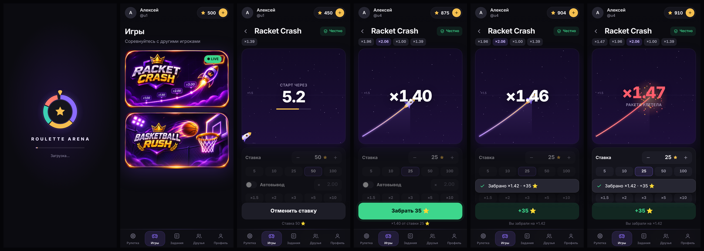

# RULIX

Telegram Mini App + бот. Игроки ставят звёзды, каждый получает сектор колеса пропорционально ставке,
победитель забирает банк раунда.


## Как работает

| | |
|---|---|
| **Рулетка** | Открывается сразу. 1 игрок — ожидание. Со второй ставкой начинается отсчёт 15 секунд, пока могут присоединиться другие. Затем колесо крутится, и победитель забирает банк (сумма ставок минус 10%, комиссия в игре не показывается). Шанс равен доле ставки. Победителя выбирает сервер (криптографический генератор случайных чисел), у всех игроков колесо останавливается в одной и той же точке. |
| **Пополнение** | Звёзды Telegram (XTR): окно оплаты открывается прямо в мини-аппе, после оплаты баланс пополняется автоматически. 1 звезда = 1 на балансе. Каждый платёж зачисляется только один раз. |
| **Вывод** | От 50, комиссия 10% (50 → 5 → к списанию 55). Сумма замораживается, администратору в бот приходит заявка с ником, ID, суммой и кнопками **✅ Отправлено** / **✖️ Отмена**. При отмене бот просит причину, игрок видит её в приложении, а звёзды возвращаются на баланс. | **Оборот перед выводом (как в казино):** после пополнения на N нужно сделать ставок на N × 3 (`WAGER_DEPOSIT`; бонусы — рефералы и задания — тоже ×3, `WAGER_BONUS`). Засчитываются только ставки после пополнения: рулетка, Crash, попытки в баскетболе; отменённые ставки не считаются; ручные начисления админа оборот не добавляют. Прогресс виден на экране вывода. Создать заявку можно только при подписке на канал `WITHDRAW_CHANNEL` (по умолчанию @safroulette; бот должен быть его администратором).
| **Задания** | Подписка на канал или чат (бот сам проверяет подписку) или переход по ссылке. Награда начисляется один раз. |
| **Друзья** | Личная ссылка-приглашение (`t.me/<бот>?startapp=ref_<id>`), «Пригласить» и копирование, список друзей с заработком с каждого. Пригласивший получает `REF_PERCENT` % (по умолчанию 15%) с **каждого пополнения** друга. Доли считаются от суммы всех пополнений, поэтому дробные части не теряются. |
| **Профиль** | Аватар Telegram, имя, ник, ID, игры, победы, поражения, карточки «Пополнить» и «Вывести», кнопка «Поддержка». |

Нижнее меню: Рулетка · Игры · Задания · Друзья · Профиль (подложка активной вкладки охватывает иконку и подпись). Над колесом: «Последняя игра», «Топ игра дня» и «Всего в банке»; в центре колеса — таймер 15 секунд, последние 5 секунд с «сердцебиением». Пополнение открывается и кнопкой «+» рядом с балансом вверху.

## Две валюты: звёзды и Gram

Справа вверху два баланса: **жёлтый — звёзды**, **синий — Gram** (криптовалюта TON). Выбранный баланс подчёркнут —
в этой валюте идут все ставки. Нажатие на другой баланс переключает валюту. Если игрок валюту не выбирал,
она выбирается сама: есть Gram — играет на Gram. Больше нигде выбора валюты нет (кроме страниц пополнения и вывода).

* **Цена Gram** берётся автоматически каждые 10 минут (tonapi.io, запасной — CoinGecko). Курс игрокам нигде не показывается.
* **Обменник** (Профиль → Обменять): звёзды ⇄ Gram в обе стороны, с выгодой для вас `EXCHANGE_SPREAD` (15%):
  Gram → звёзды по цене покупки звезды `STAR_BUY_USD` ($0,015) минус 15%, звёзды → Gram по цене продажи
  `STAR_SELL_USD` ($0,013) плюс 15%. При Gram = $1,06: 1 Gram → 60 ⭐, а за 1 Gram нужно отдать 97 ⭐.
  Обмен туда-обратно всегда в минус игроку, оборот для вывода обменом не обойти.
* **В играх** 1 Gram считается по средней цене звезды (при $1,06 — 76 ⭐): шансы в рулетке, лимиты Crash, цена попытки.
* **Рулетка:** в одном раунде можно ставить обеими валютами. Шанс считается по стоимости ставки в звёздах
  по курсу; в списке игроков видно, кто чем ставил. Победитель забирает банк в тех же валютах (минус 10%).
* **Crash и баскетбол:** ставка/попытка в выбранной валюте, выигрыш в той же валюте; лимиты пересчитываются по курсу.
* **Пополнение Gram:** через TON Connect (Telegram Wallet, Tonkeeper и др.) одним нажатием, или вручную —
  перевод на адрес `GRAM_WALLET` с комментарием = ID игрока. Сервер раз в 10 секунд проверяет входящие
  переводы (toncenter.com, ключ `TONCENTER_API_KEY` необязателен) и зачисляет каждый перевод один раз.
  Перевод без ID приходит админу в бот. Минимум — `GRAM_MIN_DEPOSIT` (0.1).
* **Вывод Gram:** игрок нажимает «Подключить кошелёк» (TON Connect) или вводит адрес вручную → «Вывести».
  Заявка приходит админу в бот и в админку с адресом в обычном виде (UQ…), админ отправляет и нажимает «Отправлено».
  Минимум — `GRAM_MIN_WITHDRAW` (0.5), комиссия 10%, нужен оборот ×3 (Gram считается по курсу).
* Чтобы включить Gram, добавьте в `.env` строку `GRAM_WALLET=UQ...` (адрес вашего кошелька) и выполните `./update.sh`.
  Без неё Gram скрыт.

## Подарки за друзей

Кнопка с подарком слева от колеса рулетки открывает вертикальную рулетку призов: 10 самых дешёвых NFT-подарков
Telegram (Snake Box, Candy Cane, Lunar Snake, Vice Cream, Chill Flame, Lol Pop, Xmas Stocking, Pool Float,
Whip Cupcake, Instant Ramen — около 4 Gram каждый) и звёзды 15 / 10 / 5 / 1.

* Каждые 5 приглашённых друзей = 1 прокрутка. Результат определяет сервер.
* Шансы: любой NFT — 1 на ~7 700 прокруток (каждый из 10 — 1 на ~77 000), 15 ⭐ — 2%, 10 ⭐ — 4%, 5 ⭐ — 14%, 1 ⭐ — ~80%.
  В среднем прокрутка даёт ~2,2 ⭐. Выигранные звёзды нужно прокрутить ×3 для вывода.
* **Промокоды:** в окне подарков есть поле «Промокод» — активация даёт одну бесплатную прокрутку (один раз на игрока).
  Создаются в админке → «Промокоды»: код и количество активаций; там же видно, сколько активировано, и можно удалить.
* Выигрыш NFT: игроку приходит сообщение, админу — уведомление в бот; подарок отправляется вручную,
  затем в админке → «Выводы» → «NFT-подарки из рулетки» нажать «Отправлено» (игрок получит сообщение).

## Обучение

* **Гид Макс** при первом входе подсвечивает элементы интерфейса и объясняет их.
* **Баскетбол:** при первой игре — бесплатная тренировка: рука показывает, как тянуть, тренер подсказывает;
  после первого попадания начинается настоящая игра.

## Игры → Racket Crash



Общие раунды для всех игроков: **8 секунд на ставки → ракета взлетает, множитель растёт → взрыв → новый раунд.**
Забрать выигрыш можно в любой момент до взрыва (кнопка «Забрать» или **автовывод** на заданном множителе).

**Математика.** Точка взрыва = `max(1, ⌊100·(1−E)/(1−r)⌋/100)`, где `r` — 52 бита HMAC-SHA256(ключ раунда, «crash:номер»).
Отсюда шанс дожить до ×m равен `(1−E)/m`, и ожидаемый возврат игроку **95% при любой стратегии** (E = 5%).
~5% раундов взрываются сразу на ×1.00.

**Честность.** До старта публикуется SHA-256 ключа раунда, после взрыва ключ раскрывается — кнопка «Честно»
показывает формулу и ключи последних раундов, любой может пересчитать результат.

**Лимиты (по умолчанию)** — подобраны моделированием реалистичных игроков (2000 смоделированных дней на сценарий):

| Параметр | Значение | Переменная окружения |
|---|---|---|
| Перевес казино | 5% | `CRASH_HOUSE_EDGE` |
| Ставка | 5 – 100 ⭐ | `CRASH_MIN_BET`, `CRASH_MAX_BET` |
| Макс. выигрыш с одной ставки (автовывод при достижении) | 1 500 ⭐ | `CRASH_MAX_WIN` |
| Макс. выплат за раунд всем (при достижении — автовывод всех по текущему множителю) | 4 000 ⭐ | `CRASH_MAX_ROUND_PAYOUT` |
| Время на ставки | 8 с | `CRASH_BETTING_MS` |

| Аудитория (модель) | Оборот/день | Доход/день (средний) | Дней в минусе | Месяцев в минусе |
|---|---|---|---|---|
| 300 раундов × 2 игрока | ≈ 14 000 ⭐ | ≈ 830 ⭐ (≈ 6%) | ≈ 31% | ≈ 2% |
| 600 раундов × 3 игрока | ≈ 42 000 ⭐ | ≈ 2 600 ⭐ | ≈ 22% | 0% |
| 2000 раундов × 8 игроков | ≈ 376 000 ⭐ | ≈ 22 400 ⭐ | ≈ 5% | 0% |

Отдельные дни могут быть в минусе (худший 1% дней при малой аудитории — около −4 500 ⭐) — держите запас звёзд.
Доход Crash за 24 ч / 7 / 30 дней — в `/admin`. Раунд, прерванный перезапуском сервера, отменяется, ставки возвращаются.

## Загрузка и полноэкранный режим

* **Онлайн:** в шапке «● N онлайн» — сколько человек открыли приложение за последние ~70 секунд (пинг раз в 30 с).
* Приложение сразу показывает свою анимацию загрузки (крупный знак по центру, название и светящаяся полоса) и предзагружает игры, картинки, звуки и данные разделов.
* На телефонах (Bot API 8.0+) приложение открывается **на весь экран**: сверху компактные кнопки Telegram
  «Закрыть» и ⌄ ⋯, контент начинается ниже них.
* **Экран загрузки Telegram (вместо 4 квадратиков):** @BotFather → `/mybots` → бот → **Bot Settings** →
  **Configure Mini App** → настройки экрана загрузки: иконка `public/brand/loading-icon.png`
  (или `.svg`), цвет фона `#0b0b10` (тёмная тема) и `#0b0b10` (светлая).

## Игры → Basketball Rush


Вкладка **«Игры»** — список игр-карточек. Карточка открывает страницу игры: приз дня, таймер до итогов,
**таблица дня** (топ-10 и ваше место), кнопки **«Мои игры»** и **«Играть за 5 ⭐»**.

* **Ежедневный турнир.** Попытка стоит фиксированно **5 ⭐** (`BASKET_PRICE`), играть можно сколько угодно —
  в таблицу идёт лучший результат игрока (от 1 очка). Места: больше очков → меньше бросков → кто раньше набрал.
* **Итоги в 00:00 по Москве** (`BASKET_TZ_OFFSET_MIN=180`): первое место получает **50 ⭐** (`BASKET_DAILY_PRIZE`),
  бот присылает победителю сообщение. Если за день никто не набрал очков — приз не выдаётся.
  Экономика: 50 ⭐ окупаются с 10 попыток за день, всё сверх — доход.
* **Обучение для новичков:** при первом нажатии «Играть» — 3 анимированных шага (как бросать, пунктир, очки и
  бонусы времени); повторно — ссылка «Как играть?».
* Старые матчи на троих со ставками при обновлении закрываются, ставки возвращаются игрокам (с уведомлением).
* **Игра:** вид сбоку, потяните назад и отпустите (пунктир показывает траекторию). Старт 30 секунд.
  Попадание = +1 очко и **+3 секунды**, чистое попадание (мяч не коснулся дужки) = +1 и **+5 секунд**.
  Щит — вид спереди, кольцо по центру под ним, без стойки; мяч отскакивает только от дужек кольца.
  Первое кольцо — в центре экрана; после каждого попадания кольцо случайно переезжает, и чем больше
  очков, тем дальше оно уходит (с 12-го попадания больше не подходит близко). Игрок ведёт мяч, пока вы не целитесь; при
  прицеливании — поднимает мяч над головой. Три звука: удар мяча об пол, бросок, толпа (громче при чистом
  попадании); кнопка звука в игре. Источники и лицензии — `public/sounds/LICENSES.md`.
* **Защита (сервер — источник правды):** клиент присылает только скорость броска, попадание и касание кольца
  считает сервер той же детерминированной физикой (`public/basket-physics.js`); время и бонусы серверные;
  номер броска против повторной отправки; новый мяч только после окончания полёта; броски без прицеливания
  отклоняются; нечеловечески ровная серия попаданий помечается, админу приходит сообщение.
  Своя случайная последовательность колец на каждую попытку.
* **Обрыв связи и перезапуск сервера:** всё хранится в базе; игрок возвращается в свою игру с тем же счётом и таймером.
* Файлы: `server/basket.js`, `public/basket.js`, `public/basket-physics.js`, `public/games/`, `public/sounds/`,
  тесты `test/basket.test.js`. Для тестов: `BASKET_BASE_MS`, `BASKET_BONUS_MS`, `BASKET_SWISH_BONUS_MS`,
  `BASKET_COUNTDOWN_MS`; настройки турнира: `BASKET_PRICE`, `BASKET_DAILY_PRIZE`, `BASKET_TZ_OFFSET_MIN`.

## Админ-панель (в мини-аппе)

Открывается только у администратора (`ADMIN_ID`): **Профиль → Админ-панель**. Заявки на вывод по-прежнему
приходят и в бот с кнопками. В меню бота — только `/start`.

* **Онлайн:** зелёная точка у аватара — игрок сейчас в приложении; кнопка «Онлайн N» показывает только их.

* **Игроки** — все пользователи, отсортированы по балансу (у кого больше — выше), поиск по нику, имени или ID.
  Карточка игрока: баланс, пополнения (сумма, сколько раз, первое и последнее), выводы (выполненные, в обработке,
  отменённые, комиссия), доход с рефералов и заданий, изменения админом, оборот для вывода, по каждой игре —
  сколько ставок и на сколько, сколько выигрышей и на сколько, итог в плюс или минус, рекорд в баскетболе и
  подозрительные попытки, кто пригласил и сколько друзей, **полный журнал всех действий** с датами
  и **сверка баланса с журналом**.
  Действия: **изменить баланс** (`100` начислить, `-50` списать), **написать** (сообщение придёт от бота),
  **заблокировать / разблокировать**.
* **Выводы** — заявки в обработке с кнопками «Отправлено» и «Отменить» (с причиной), история обработанных.
* **Рассылка** — текст и/или фото, всем незаблокированным, с кнопкой «Играть»; прогресс доставки.
* **Задания** — ссылка, название (необязательно), награда; список активных с числом выполнивших, удаление.
* **Сводка** — пользователи, пополнения, доход рулетки, Crash и баскетбола за 24 часа, 7 и 30 дней.

### Безопасность

* Каждый запрос подписан Telegram (`initData`, HMAC-SHA256 на токене бота): подменить ID, баланс или чужой
  аккаунт нельзя. Админ-запросы дополнительно требуют свежую сессию (не старше 6 часов).
* Баланс меняется только на сервере, в транзакциях SQLite, с записью в журнал; баланс не может уйти ниже нуля.
  В карточке игрока видно, совпадает ли баланс с журналом.
* Игры полностью серверные: исход рулетки, точку взрыва Crash и попадания в баскетболе считает сервер,
  клиент присылает только действие (ставку, вывод, скорость броска).
* Пополнения: счёт проверяется (валюта XTR, сумма, тот же пользователь), повтор платежа не зачисляется дважды.
* Выводы: оборот ×3, подписка на канал, одна заявка в обработке за раз, не больше 3 заявок в сутки.
* Ограничение частоты запросов по пользователю и IP, лимит размера запросов, лимит подключений к потоку.
* Заголовки безопасности (CSP, nosniff, HSTS), запрет открытия скрытых файлов. Режим разработки
  (`DEV_MODE`) не действует, если задан токен бота.

## Установка на сервер

Нужен сервер с Ubuntu или Debian и доступом по SSH (хватит 1 ГБ RAM).

```bash
git clone -b ccr-d7544e66-jbiegp https://github.com/safarzod10-ship/safarzod.git roulette-arena
cd roulette-arena
sudo ./setup.sh
```

Скрипт задаст три вопроса: **токен бота** (@BotFather), **ваш Telegram ID** (узнать у @userinfobot),
**ник для кнопки «Поддержка»**. Всё остальное он сделает сам: поставит Docker, получит HTTPS, запустит.
В конце покажет ссылку на бота.

> Если репозиторий приватный, `git clone` спросит логин и пароль. Логин — ваш GitHub-ник, пароль — токен:
> GitHub → Settings → Developer settings → Personal access tokens → Fine-grained → Generate,
> доступ к этому репозиторию: Contents → Read-only.

### Оплата звёздами

Звёзды Telegram включены для всех ботов, ничего подключать не нужно. Чтобы бот принимал оплату, он
по правилам Telegram должен отвечать на `/paysupport`: бот отвечает на эту команду, но в меню её нет.

### Ссылки-приглашения открывают мини-апп сразу

Ссылка друга имеет вид `https://t.me/<бот>?startapp=ref_<id>`. Чтобы она открывала игру, а не чат с ботом,
включите у бота **Main Mini App**: @BotFather → `/mybots` → бот → **Bot Settings** → **Configure Mini App** →
**Enable Mini App** → пришлите адрес игры (строка `DOMAIN` в `.env`, в виде `https://…/`).
Без этого Telegram откроет чат с ботом, а приглашение не засчитается.

## 24/7

Оба контейнера запущены с `restart: unless-stopped`: при сбое они перезапускаются сами,
после перезагрузки сервера Docker запускает их автоматически. Ничего держать открытым не нужно,
SSH можно закрыть.

## Команды

Выполнять в папке `roulette-arena`:

| Что | Команда |
|---|---|
| Обновить после изменений в GitHub | `./update.sh` |
| Состояние | `sudo docker compose ps` |
| Логи | `sudo docker compose logs -f app` |
| Перезапуск | `sudo docker compose restart` |
| Остановить | `sudo docker compose down` (данные сохраняются) |
| Резервная копия базы | `sudo docker run --rm -v roulette-arena_app_data:/data -v "$PWD":/b alpine tar czf /b/backup-$(date +%F).tgz -C /data .` |
| Сменить токен / админа | `sudo rm .env && sudo ./setup.sh` |

## Структура

```
server/
  index.js    HTTP API, раздача мини-аппа, живые обновления раунда (SSE)
  game.js     игровой движок: раунды, отсчёт, выбор победителя, банк
  db.js       SQLite: игроки, балансы, ставки, платежи, заявки, журнал операций
  auth.js     проверка подписи Telegram initData
  bot.js      бот: /start, кнопка меню, оплата Stars, заявки на вывод для админа
  config.js   настройки и лимиты
public/       мини-апп (HTML/CSS/JS без сборки)
test/         автотесты: npm test
Dockerfile, docker-compose.yml, Caddyfile, setup.sh, update.sh
```

Локальная разработка без Telegram: `npm run dev`, затем открыть `http://localhost:3000/?dev=1&uid=1&name=Тест`
(пополнение в этом режиме зачисляется без оплаты).
