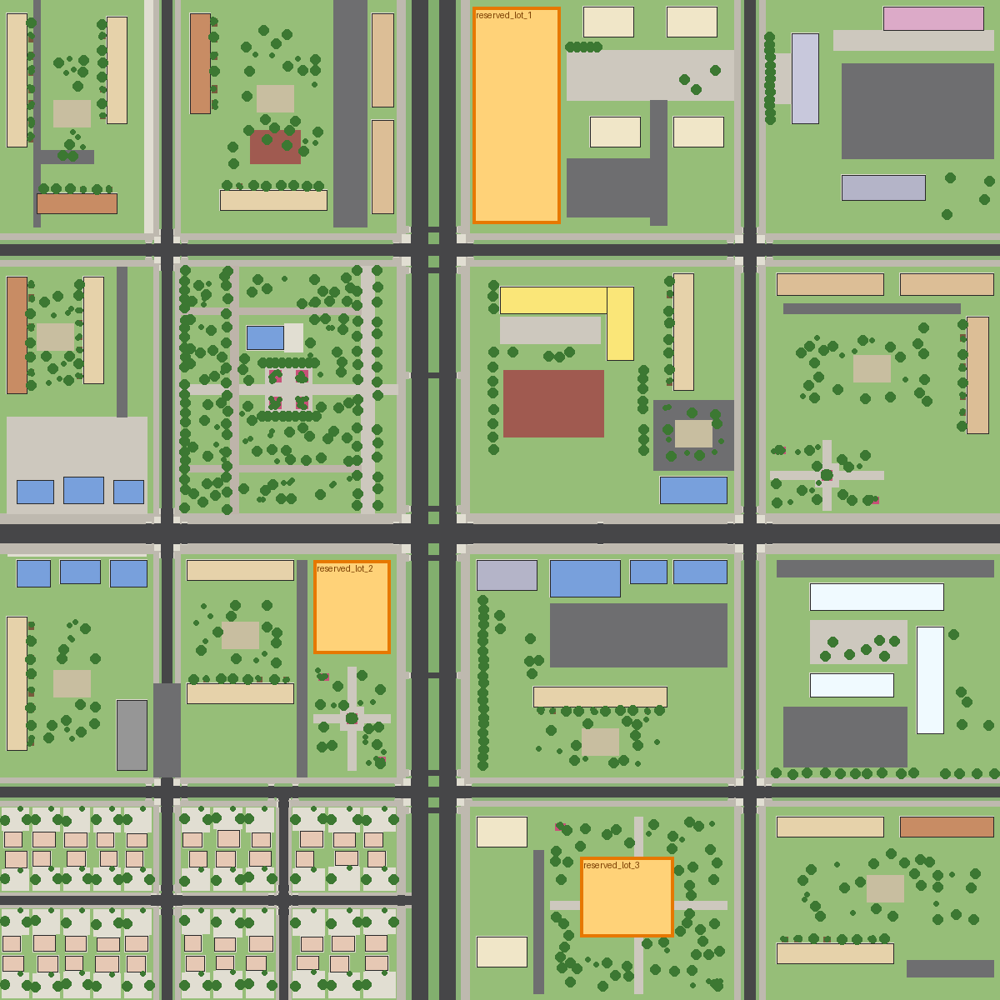

# Город: исследование, планировка, техника

## 1. Исследование реального Душанбе

Источники (поиск в интернете в ходе работы):
* Описания и фото районов: путеводители и статьи о советском модернизме Центральной Азии
  ([Greyscape](https://www.greyscape.com/soviet-modernism-in-central-asia/)), материалы о махаллях
  ([WeProject](https://weproject.media/articles/detail/5-atmosfernykh-makhalley-dushanbe-gde-mozhno-pochuvstvovat-staryy-gorod/)),
  об озеленении ([Global Voices: вырубка чинар](https://globalvoices.org/2014/02/20/they-fell-our-souls-and-memory-felling-of-trees-draws-anger-in-tajikistan/),
  [AKDN: Greening Dushanbe](https://the.akdn/en/resources-media/whats-new/in-the-media/aga-khan-development-network-organises-tree-planting-campaign-in-dushanbe),
  [дендрология парков Душанбе, JARTS](https://jarts.info/index.php/jarts/article/view/53)),
  о проспекте Рудаки и транспорте ([Wikipedia](https://en.wikipedia.org/wiki/Rudaki_Avenue)),
  о языке вывесок ([Gacek, «Modern Tajik public inscriptions»](https://ejournals.eu/en/journal/studia-linguistica-uic/article/some-remarks-on-the-language-of-modern-tajik-public-inscriptions-part-i)).
* Ограничение: доступа к уличным панорамам и фотобанкам из среды сборки не было. Систематического
  фотообследования (фото → замеры) не проводилось. Наблюдения ниже взяты из найденных материалов и общих
  знаний о городе. Их стоит сверить с собственными фото.

Что перенесено в город:

| Наблюдение | Реализация |
|---|---|
| Советские 5-этажки (панельные и кирпичные) вокруг зелёных дворов, 9-этажки вдоль проспектов | `panel5`, `brick5`, `panel9`, дворы с площадками, столами, выбивалками, контейнерными площадками |
| Пастельные фасады (кремовый, жёлтый, персиковый, светло-зелёный, голубой) | палитра `PASTEL` в `buildings.py` (тонировка через вершинный цвет) |
| Балконы, застеклённые жильцами вразнобой, ковры на перилах, тарелки, кондиционеры | балконы `glazed/sheet/rail` со случайным выбором, ковёр 12%, тарелки и сплит-системы как экземпляры |
| Жёлтые газовые трубы вдоль фасадов, решётки на окнах первых этажей | `gas_pipe()`, решётки с вероятностью по типу здания |
| Квартиры первых этажей переделаны в магазины с отдельным крыльцом и большой вывеской | `shopfront()`: крыльцо, ступени, перила, вывеска на таджикском, иногда маркиза |
| Новостройки 12–16 этажей: травертин внизу, бежевая штукатурка, пояса, коммерческий первый этаж | `tower` с `base_floors=2`, `belt_every=4`, акцентными углами |
| Махалли: глухие дувалы 2,2 м, крашеные металлические ворота, айваны, токзор (виноградник) | `mahalla()`, дувал с кирпичным верхом, ворота, `aivan()`, `grape_trellis` |
| Широкие проспекты с бульваром и арыками, деревья по обе стороны арыка | профиль `av`: 3+3 полосы × 3,5 м, бульвар 6 м, полоса с арыком 3,2 м, тротуар 5 м |
| Чинары, карагачи, пирамидальные тополя, белая акация, тутовник, восточная туя, розы, побелённые стволы | 11 видов деревьев/кустов, побелка ствола в шейдере коры |
| Вывески и таблички на таджикском (кириллица с Ҳ Ӣ Ӯ Қ Ғ Ҷ), часто с дублем по-русски | атлас вывесок: ДОРУХОНА, МАҒОЗА, НОНВОЙХОНА, ЧОЙХОНА, САРТАРОШХОНА, БЕМОРХОНАИ ШАҲРӢ № 3, МАКТАБИ … № 45 и др. |
| Чайхана с топчанами, металлические гаражи, детские площадки | топчаны, ряд гаражей, качели, горка, песочница-грибок |
| Гиссарский хребет на севере, виден из любой точки города | фон: процедурные хребты (сжатое расстояние, угловой размер сохранён) |

## 2. Планировка (600 × 600 м, координаты: +X восток, −Z север, метры)

* Проспект «хиёбони Ҷавонон» (север–юг, x = −40): ширина 43 м.
* Улицы: Бахор (z = −150), коммерческая Гулистон (z = 20, парковочные карманы, деревья в приствольных решётках),
  Навбаҳор (z = 175), Меҳргон (x = 150), Деҳқонон (x = −200). Переулки махалли: Боғ и Чашма.
* Кварталы: микрорайон пятиэтажек (северо-запад); девятиэтажки на проспекте; новый ЖК и резервный участок № 1;
  администрация района, гостиница, офисный центр; парк с аллеями, клумбами и чайханой; школа № 45 со стадионом;
  девятиэтажки со сквером; павильоны, чайхана, автосервис; пятиэтажки с магазинами и резервный участок № 2;
  супермаркет, кафе, парковка; городская больница № 3 (3 корпуса, приёмное отделение, сад, ограда);
  махалля из 44 частных домов; ЖК с резервным участком № 3 в сквере; пятиэтажки с гаражами.
* Остановки: проспект (2 × 2), Гулистон, Меҳргон. Регулируемые перекрёстки: проспект × Гулистон/Бахор/Навбаҳор,
  Меҳргон × Гулистон. Наземные переходы со светофорами посреди кварталов: проспект у парка и у сквера, Гулистон у остановок.
* Резервные участки (пустые, данные в `data/city/city.json → reserved_lots`):
  1. `reserved_lot_1`: x −16,5…36, z −296…−166 (≈52 × 130 м, у проспекта);
  2. `reserved_lot_2`: x −112…−66, z 36…92 (≈46 × 56 м, угол проспекта и Гулистон);
  3. `reserved_lot_3`: x 48…104, z 214…262 (≈56 × 48 м, центр сквера).
* Расширение: город делится на чанки по 100 м. Новый квартал = новые дороги в `layout.ROADS` и план
  в `layout.plan()`. Дороги, бордюры, переходы, разметка и коллизии строятся автоматически.

## 3. Как строится город

1. `layout.py`: дороги (профили поперечных сечений) и план каждого квартала (здания, покрытия, деревья,
   объекты, ограждения, парковки, резервы).
2. `streets.py`: алгебра прямоугольников. Проезжие части, бульвары, газоны с арыками, тротуары,
   скруглённые бордюры на углах (дуги), «зебры» по ГОСТ, пандусы 1,2 м у каждого перехода, стоп-линии,
   разметка полос (пунктир 3/9 м), сплошные у перекрёстков, ливнёвки каждые 32 м, люки.
3. `buildings.py`: фасад делится на оси и этажи. Проёмы вырезаются в стене (сетка с объединением ячеек),
   у каждого окна есть откосы, рамы, импосты, отлив, стекло с интерьером из атласа. Балконы, подъезды
   (крыльцо, ступени, перила, козырёк, дверь с ручкой, домофон, лампа), магазины, цоколь с продухами,
   швы панелей, карниз, парапет, машинные помещения, вентиляция, антенны или скатная крыша из профнастила,
   водостоки, газовые трубы. Детали (рамы, отливы, трубы, перила) вынесены в отдельный меш «detail»,
   он скрывается на расстоянии.
4. `build_city.py`: всё сводится в 36 чанков (меши по материалам) и JSON экземпляров. Улицы автоматически
   получают деревья, фонари (двойные на бульваре, одиночные на тротуарах), скамейки, урны, светофоры,
   знаки 5.19/5.16/6.4, остановки с жёлтой разметкой 1.17, велопарковки, столбы ЛЭП в махалле.
5. `validate_city.py`: проверки связности пешеходной сети, пересечений, резервов, объектов на проезжей части.
6. Godot `CityWorld`: грузит чанки, подменяет материалы на PBR-библиотеку, создаёт коллизии (боксы)
   и MultiMesh для 1805 деревьев и 3944 объектов с цепочкой LOD (LOD0 → LOD1 → импостор).

## 4. Материалы и освещение

* PBR CC0 (ambientCG): асфальт, плитка, штукатурка, панели, кирпич, травертин, бетон, металл, профнастил,
  трава, земля, гравий, дерево, кора, листья. Шейдер `city_pbr`: альбедо/нормали/ORM, тонировка и AO
  из вершинного цвета, мировая макровариация против повторов текстуры, мокрые поверхности (подготовлено).
* Стекло: атлас интерьеров (тюль, шторы, жалюзи, комнаты), отражения неба, ночью горит часть окон.
* Небо процедурное. Солнце по астрономической формуле для 38,56° с. ш. (по умолчанию 15:30, конец мая).
  Каскадные тени, туман с воздушной перспективой, тонмаппер AgX, лёгкий glow. Нейтрально-тёплый ambient
  (небо даёт только 22%), иначе тени синели.
* День и ночь: `TimeOfDay.set_hour()`, глобальный `city_night`. Ночью горят окна, вывески и лампы,
  светит луна, экспозиция растёт («адаптация глаза»), пул из 6–8 точечных источников стоит у ближайших
  фонарей (лимит мобильного рендерера — 8 источников на меш).

## 5. Оптимизация Android

* Чанки 100 м, детали фасадов: дальность 120 / 160 / 220 м (Low / Medium / High).
* Деревья: LOD0 до 45–110 м, LOD1, импосторы из трёх карточек до 260–700 м.
* Трава: MultiMesh вокруг камеры на газонах, радиус 10 / 16 / 24 м с плавным угасанием.
* Пресеты Low / Medium / High: масштаб рендера 0,7 / 0,85 / 1,0, MSAA, тени (каскады, дальность, размер атласа),
  трава, дальность деревьев и объектов, glow, размер отражений неба.
* Коллизии упрощены: коробки (здания, газоны, тротуары, ступени), цилиндры (стволы, столбы).
* Исходники в высоком качестве (2K-текстуры, .blend, сырые загрузки) хранятся отдельно, в `dushanbe_city_src/`.

## 6. Известные ограничения

* FPS на телефоне не измерялся: устройства нет. Замеры с сервера (программный рендер) скорость телефона не показывают.
* Рельеф плоский (реальный центр Душанбе имеет небольшой уклон к югу).
* Пешеходные пандусы проходимы за счёт подъёма на ступени высотой до 0,32 м, отдельной наклонной коллизии нет.
* Импосторы дальних деревьев: на одной из карточек иногда виден пересвет при низком солнце.
