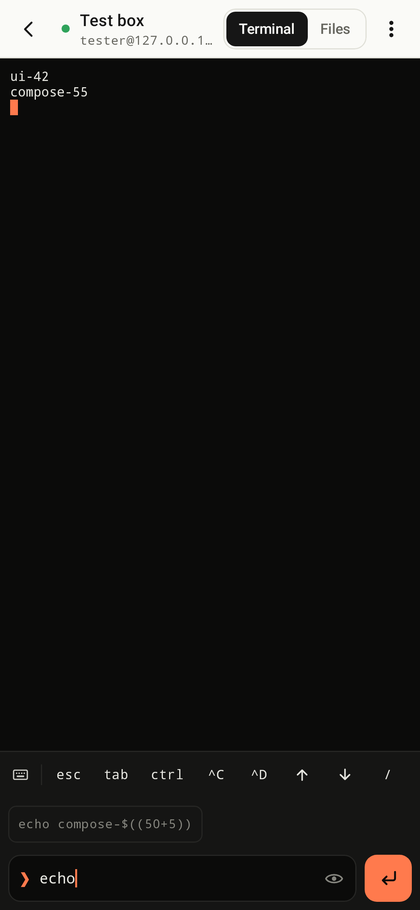
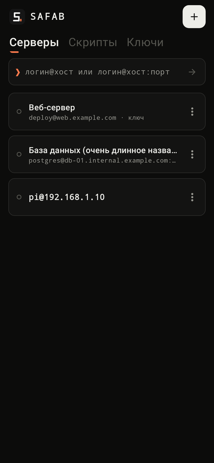

# SAFAB

 &nbsp; 

Бесплатный Android-клиент SSH и SFTP с открытым исходным кодом: терминал, файловый менеджер,
вход по ключам, сохранённые скрипты. Без рекламы, аналитики, регистрации и платных зависимостей.

| Серверы | Терминал: ввод прямо в нём | Терминал: отдельное поле | Тёмная тема |
|---|---|---|---|
|  |  |  |  |

Планшет / альбомная ориентация — сетка в несколько колонок:


**Руководство пользователя: [docs/USER_GUIDE.md](docs/USER_GUIDE.md)**

**Разработчик, владелец и поддержка:** Telegram [@bob_proger](https://t.me/bob_proger)

## Возможности

- Быстрое подключение одной строкой: `логин@хост` или `логин@хост:порт` — сервер сохраняется сам.
- Несколько сохранённых серверов (хост, порт, логин, пароль или ключ), дублирование, правка, удаление.
- Терминал с двумя способами ввода, переключаются одной кнопкой:
  **прямо в терминале** (каждая клавиша сразу уходит в оболочку: Tab-дополнение, история стрелками,
  пароли не отображаются) и **в отдельном поле** (команда набирается и правится целиком, подсказки из
  истории, одноразовый скрытый ввод). Ряд клавиш: esc, tab, липкий ctrl, ^C, ^D, стрелки, частые символы.
- Работа в фоне: пока открыт хотя бы один сеанс, приложение держит служебное уведомление
  (foreground service), и соединения не рвутся при сворачивании.
- SFTP: просмотр каталогов, загрузка нескольких файлов, скачивание, создание папок, переименование,
  удаление (в том числе папок целиком), индикатор прогресса и отмена передачи.
- SSH-ключи: создание Ed25519 / RSA-3072 прямо в приложении, импорт из файла или вставкой текста
  (форматы OpenSSH, PEM, PuTTY; ключи с парольной фразой поддерживаются).
- Скрипты: наборы команд, запуск последовательно (с остановкой на первой ошибке) или одновременно,
  код выхода, длительность и вывод каждой команды.
- Проверка ключа сервера: при первом подключении показывается отпечаток, при его изменении — предупреждение.
- Пароли и приватные ключи шифруются AES-256-GCM ключом из Android Keystore и не попадают в резервные копии.
- Собственный минималистичный интерфейс (без стандартных панелей Android), фирменный знак с анимацией на загрузках, русский и английский язык, светлая и тёмная темы, адаптация под телефоны, планшеты и альбомную ориентацию.

## Требования

Android 8.0 (API 26) и новее. Разрешения: интернет, фоновая служба для открытых сеансов и (Android 13+)
уведомления — чтобы показывать, что сеансы открыты.

## Сборка APK

Нужны JDK 17+ и Android SDK (platform 36, build-tools 36). Всё остальное Gradle скачает сам.

```bash
cd ssh-client
echo "sdk.dir=/путь/к/android-sdk" > local.properties
./gradlew assembleRelease        # app/build/outputs/apk/release/app-release.apk
./gradlew assembleDebug          # app/build/outputs/apk/debug/app-debug.apk
```

### Подпись релиза

Без настроек релизный APK подписывается отладочным ключом (устанавливается, но обновить его сборкой
с другой машины не получится). Для постоянной подписи создайте хранилище и файл `keystore.properties`
рядом с `settings.gradle.kts` (оба файла исключены из Git — никогда не коммитьте их):

```bash
keytool -genkeypair -keystore release.keystore -storetype PKCS12 -alias safab \
        -keyalg RSA -keysize 4096 -validity 10950 -dname "CN=SAFAB"
```

```properties
storeFile=release.keystore
storePassword=...
keyAlias=safab
keyPassword=...
```

Обновление поверх установленного приложения возможно только APK с той же подписью — храните
хранилище ключей и пароль в надёжном месте.

## Тесты

```bash
./gradlew testDebugUnitTest      # 69 тестов
./gradlew lintDebug
```

| Набор | Что проверяет |
|---|---|
| `CoreUnitTest` | разбор вывода терминала (CR, backspace, escape-последовательности, UTF-8 по частям, позиция курсора), управляющие клавиши, разбор строки `логин@хост:порт`, скриптов, путей |
| `SshIntegrationTest` | настоящий SSH-сервер внутри теста (Apache MINA SSHD): пароль, ключи Ed25519/RSA, парольная фраза, неизвестный и изменившийся ключ хоста, отказ/тайм-аут/несуществующий хост, exec, оболочка, SFTP, отмена загрузки, удаление без перехода по симлинкам, последовательные и параллельные скрипты, обрыв соединения |
| `AndroidCryptoPathTest` | полное подключение через встроенный Bouncy Castle (curve25519 + ed25519) — тот путь, который используется на телефоне |
| `RepositoryTest` | сохранение и восстановление данных, секреты не пишутся на диск открытым текстом, повреждённый файл данных |
| `UiFlowTest` | реальный интерфейс (Robolectric): создать сервер → подтвердить ключ сервера → команды в обоих режимах ввода → файлы → скрипт; быстрое подключение; сообщения об ошибках; загрузка и скачивание |
| `ScreenshotTest` | вёрстка на 320dp-телефоне, телефоне, альбомной ориентации и планшете, RU/EN, светлая/тёмная тема (снимки в `app/build/screenshots`) |
| `RealOpenSshTest` | необязательные проверки на настоящем OpenSSH (реальный PTY, bash, sftp-server). Включаются переменной `SSHPULT_REAL_SSH=host:port:user:password` — только для тестовой учётной записи |

## Устройство проекта

```
app/src/main/java/app/sshpult/
  ssh/    ядро без зависимостей от Android: подключение и ошибки (SshCore), терминал (Terminal),
          SFTP (Sftp), ключи (KeyTools), скрипты (ScriptRunner), живые сессии (SessionManager)
  data/   модели, хранилище в JSON (AppRepository), шифрование секретов (SecretCipher)
  ui/     экраны на Jetpack Compose / Material 3
```

Библиотеки (все бесплатные и открытые): [JSch (mwiede)](https://github.com/mwiede/jsch) — BSD,
[Bouncy Castle](https://www.bouncycastle.org/) — MIT, AndroidX / Jetpack Compose, Kotlin,
kotlinx.coroutines и kotlinx.serialization — Apache 2.0.

## Фирменный знак

Квадратная «S», написанная одним штрихом, и курсор терминала. Геометрия одна и та же в иконке приложения
(`res/drawable/ic_launcher_foreground.xml`), в интерфейсе и в анимации загрузки (`ui/Brand.kt`): штрих стирается
и пишется заново, курсор мигает. Файлы для использования вне приложения — в `docs/brand/`.

Идентификатор пакета остался `app.sshpult`, чтобы новые версии ставились поверх уже установленных.

## Известные ограничения

- Терминал — командная консоль (`TERM=dumb`), а не полный эмулятор VT100: полноэкранные программы
  (`vim`, `nano`, `htop`, `mc`) в нём не работают. Для правки файлов используйте скачивание/загрузку по SFTP.
- Фоновая служба не даёт системе выгрузить приложение, но при долгом простое с выключенным экраном
  Android (режим Doze) может приостановить сеть — тогда сеанс оборвётся и его нужно открыть заново.
  Передача файла прерывается, если закрыть экран сеанса.
- Нет проброса портов, SSH-агента, jump-хостов и двухфакторной аутентификации с вводом кода.
- Приватные ключи нельзя экспортировать из приложения (намеренно).
