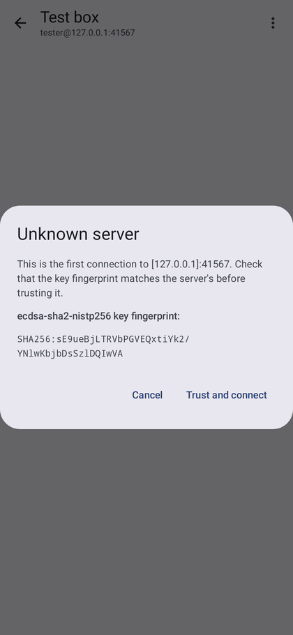
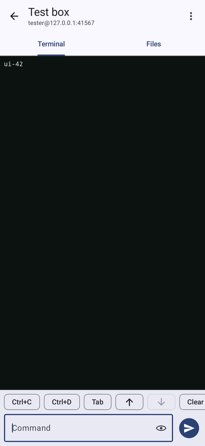
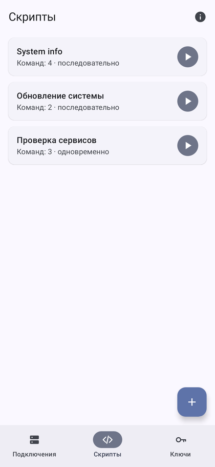
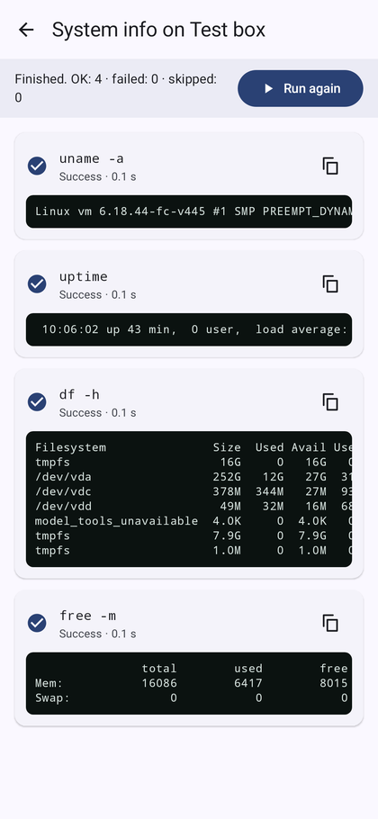

# SSH Пульт — руководство пользователя

## 1. Установка

1. Скопируйте файл `ssh-pult-1.0.0.apk` на телефон (или скачайте его прямо на телефоне).
2. Откройте файл. Android попросит разрешить установку из этого источника
   («Настройки → Установка неизвестных приложений») — разрешите и нажмите «Установить».
3. Запустите «SSH Пульт». Требуется Android 8.0 или новее.

Внизу экрана (на планшете — слева) три вкладки: **Подключения**, **Скрипты**, **Ключи**.

## 2. Первое подключение

| | |
|---|---|
|  |  |

1. На вкладке «Подключения» нажмите **+**.
2. Заполните поля:
   - **Название** — любое, для себя (можно не заполнять);
   - **Хост или IP** — например `example.com` или `192.168.1.10`;
   - **Порт** — обычно `22`;
   - **Имя пользователя** — учётная запись на сервере;
   - **Пароль** — будет сохранён в зашифрованном виде. Оставьте поле пустым, если хотите вводить
     пароль при каждом подключении (он тогда нигде не сохраняется).
3. Нажмите **Сохранить**, затем нажмите на карточку подключения.
4. При первом подключении появится окно **«Неизвестный сервер»** с отпечатком ключа. Сверьте его
   с отпечатком сервера (на сервере: `ssh-keygen -lf /etc/ssh/ssh_host_ed25519_key.pub`) и нажмите
   **«Доверять и подключиться»**. В дальнейшем вопрос не задаётся.

> **Если появилось предупреждение «ключ сервера изменился»** — не продолжайте, пока не выясните
> причину. Это нормально после переустановки сервера, но так же выглядит перехват соединения.

Меню **⋮** на карточке: изменить, дублировать, удалить подключение. Открытые сеансы помечены
надписью «Подключено».

## 3. Терминал



- Введите команду в поле внизу и нажмите кнопку отправки (или «Отправить» на клавиатуре).
- Это одна постоянная сессия: `cd`, переменные окружения и т. п. сохраняются между командами.
- Кнопки над полем ввода: **Ctrl+C** (прервать команду), **Ctrl+D** (конец ввода / выход),
  **Tab**, **↑ / ↓** (история ваших команд), **Очистить**, **Копировать всё**.
- Значок глаза в поле ввода скрывает набираемый текст — включайте его перед вводом пароля,
  например после `sudo`. После отправки скрытие выключается само, и такая строка не попадает в историю.
- Чтобы выделить часть вывода, удерживайте палец на тексте.
- Полноэкранные программы (`vim`, `nano`, `htop`) не поддерживаются — см. ограничения в README.

Меню **⋮** вверху: «Запустить скрипт» и «Отключиться». Кнопка «Назад» сеанс не разрывает —
к нему можно вернуться с главного экрана.

## 4. Файлы (SFTP)


Вкладка **«Файлы»** на экране сеанса.

- Нажатие на папку открывает её; стрелка вверх — родительская папка; круговая стрелка — обновить.
- **Загрузить на сервер**: значок со стрелкой вверх → выберите один или несколько файлов на
  устройстве. Они попадут в открытую папку. Если файл с таким именем уже есть, новый получит
  имя вида `файл (2).txt` — существующие файлы не перезаписываются.
- **Скачать**: нажмите на файл (или **⋮** справа) → «Скачать» → выберите, куда сохранить.
- **Новая папка**: значок папки с плюсом.
- **Переименовать / Удалить**: меню **⋮** у файла или папки. Папка удаляется вместе с содержимым —
  приложение спросит подтверждение. Удаление с сервера необратимо.
- Во время передачи внизу виден прогресс; крестик отменяет её (недокачанный файл удаляется).

## 5. Вход по SSH-ключу

| | |
|---|---|
|  |  |

**Создать новый ключ**

1. Вкладка «Ключи» → **+** → «Создать новый ключ».
2. Введите название, оставьте тип **Ed25519** (RSA — только для очень старых серверов).
3. Приложение покажет **публичный ключ**. Нажмите «Копировать».
4. Добавьте эту строку на сервер в файл `~/.ssh/authorized_keys` нужного пользователя. Проще всего
   так: подключитесь по паролю и выполните в терминале (вставив скопированную строку):
   ```
   mkdir -p ~/.ssh && chmod 700 ~/.ssh
   echo 'ВСТАВЬТЕ_СТРОКУ_КЛЮЧА' >> ~/.ssh/authorized_keys && chmod 600 ~/.ssh/authorized_keys
   ```
5. Откройте подключение на изменение (**⋮ → Изменить**), выберите аутентификацию **«SSH-ключ»**,
   отметьте ключ и сохраните.

**Использовать существующий ключ**

«Ключи» → **+** → «Импорт из файла» (файл приватного ключа, например `id_ed25519`) или «Вставить
текст ключа». Если ключ защищён парольной фразой, введите её — она сохранится зашифрованной.
Поддерживаются форматы OpenSSH, PEM и PuTTY (.ppk).

Публичный ключ всегда можно посмотреть и скопировать, нажав на карточку ключа. Приватный ключ
из приложения не выгружается. При удалении ключа приложение предупредит, какие подключения
перестанут работать.

## 6. Скрипты

| | |
|---|---|
|  |  |

Скрипт — сохранённый список команд, по одной в строке.

1. Вкладка «Скрипты» → **+**. Введите название и команды. Строки, начинающиеся с `#`, пропускаются.
2. Выберите режим:
   - **Последовательно** — команды идут одна за другой. Переключатель «Остановиться на первой
     ошибке» прерывает выполнение, если команда завершилась неуспешно (остальные помечаются
     «Пропущено»).
   - **Одновременно** — все команды запускаются параллельно (не более 4 одновременно).
3. Запуск: кнопка ▶ на карточке скрипта → выберите сервер. Либо из открытого сеанса:
   **⋮ → Запустить скрипт**.
4. Для каждой команды показываются статус, код выхода, длительность и вывод. Вывод можно
   скопировать значком справа. «Остановить» прерывает выполнение, «Запустить снова» повторяет.

**Важно:** каждая строка выполняется как отдельная команда в новом окружении. `cd /var/log` в одной
строке не повлияет на следующую. Объединяйте: `cd /var/log && tail -n 20 syslog`.
Команды, которые ждут ввода (например `sudo` с запросом пароля), в скрипте зависнут до
тайм-аута в 10 минут — используйте для них терминал.

## 7. Сообщения об ошибках

| Сообщение | Что проверить |
|---|---|
| Не удалось войти. Проверьте имя пользователя и пароль | Логин и пароль; кнопка «Ввести другой пароль» позволяет попробовать ещё раз, не меняя настройки |
| Сервер не принял этот ключ | Публичный ключ добавлен в `~/.ssh/authorized_keys` именно этого пользователя; права `700` на `~/.ssh` и `600` на файл |
| Сервер «…» не найден | Опечатку в адресе, подключение к интернету / VPN |
| Сервер отклонил соединение | Порт и то, что служба SSH запущена |
| Сервер не ответил вовремя / недоступен | Сеть, файрвол, правильность IP-адреса |
| Соединение с сервером потеряно | Нажмите «Подключиться снова» |
| Нет доступа: … | У пользователя нет прав на этот файл или папку |
| Приватный ключ … неподдерживаемый формат | Импортируйте именно приватный ключ (не `.pub`) целиком, со строками `-----BEGIN…` и `-----END…` |

## 8. Безопасность и данные

- Пароли, приватные ключи и парольные фразы шифруются ключом из Android Keystore и хранятся только
  в памяти приложения на этом устройстве. Они не включаются в резервные копии и не передаются
  никуда, кроме сервера, к которому вы подключаетесь.
- При переносе на новый телефон подключения и ключи нужно будет добавить заново.
- Удаление приложения удаляет все сохранённые данные.
- Приложение не содержит рекламы и аналитики и не обращается ни к каким серверам, кроме ваших.
